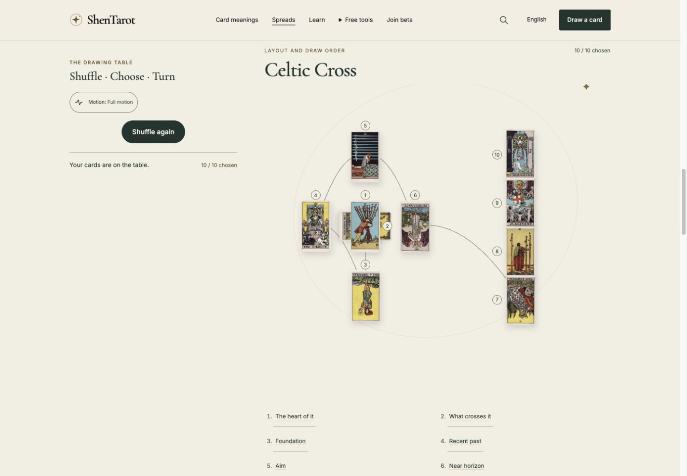
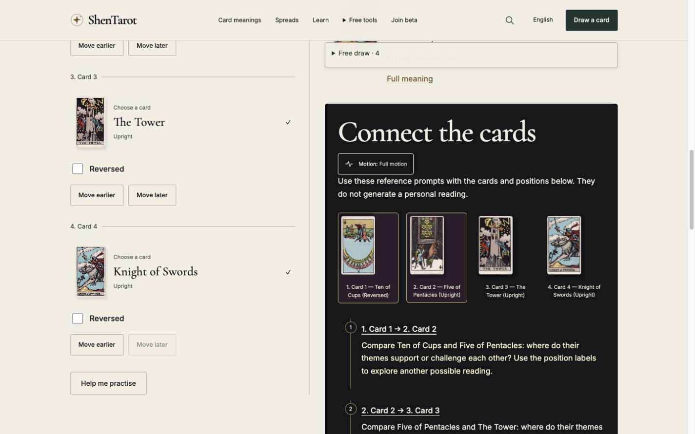
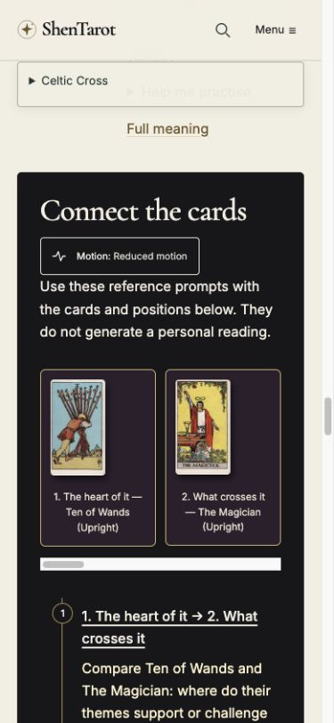

# Website ritual and connected-reading refinement

27 October 2026 · Local branch `feat/ritual-interactions` · Not published

This phase changed website code and documentation only. The mobile app, backend, store configuration, prices and credits were untouched. Prior uncommitted website/research work was preserved.

## Findings and changes

1. **The draw ended before the reading workspace.** Completed draws now offer **Explore & reflect** immediately after the drawing stage. Exact card IDs, orientations, applied spread and the question travel through tab-local session storage. Questions never enter the handoff URL or an AI request. A destination confirmation protects existing cards/questions; impressions, reflection notes and the separately saved snapshot remain.
2. **Redraw protection existed only in the design-study prototype.** The real Reader now uses the shared accessible dialog. Escape/Keep these cards preserves the draw; confirmation replaces cards, retains the question and focuses the new fan. The study uses this shared behavior rather than presenting two confirmations.
3. **Back restored the form but lost the completed draw.** A validated receipt, scoped to the source path in this tab, restores completed cards and questions after navigation/reload. A deliberate new shuffle clears it. A new recommendation question takes precedence. Daily-card selection still follows its existing daily-cache rules. Yes-or-No scoring mode is restored with its applied spread.
4. **Free draws could not fit the workspace’s named spreads.** The website workspace now supports stable `draw_1`–`draw_10` position sets, using localized card numbers. Saved drafts and homepage resume validate these sets without changing the version-1 draft schema. No new spread pages or app/backend definitions were added.
5. **Controls and relationship text competed with the cards.** Open rows, fine rules and tactile artwork replace nested input/card boxes. Relationship selectors show short position labels; their accessible names retain card names and orientations. The initial pair is visibly selected. Phone references form a native horizontal ribbon that follows the selected pair without moving the whole page. Reference links focus the matching explanation below sticky navigation.
6. **Manual reduced motion reset on navigation.** Its preference now persists within the same tab, while OS reduced motion still takes precedence. Denied storage leaves the control usable for the current page.

The website still provides reference meanings and practice prompts. No production AI integration, tracking, dependency, merge, release or indexing submission was added. The existing English generator explanation now accurately distinguishes ordinary 25% reversals from Yes-or-No’s 50% rule.

## Interfaces and storage

- `/read?draw=1` is a transient arrival flag; it contains no personal text or cards and is consumed after handling.
- `shentarot-draw-transfer-v1` stores one pending validated version-1 Draft in session storage. Invalid/incomplete/concealed/duplicate/unknown-card payloads are rejected. A denied write keeps the visitor on the drawing page with recovery text.
- Source receipts use `shentarot-draw-transfer-v1-return:<pathname>`. They hold completed cards and question, not a continuing shuffled deck. Fixed-spread pages accept only their compatible receipt.
- Existing workspace session drafts and the single local saved snapshot keep their existing keys/schema. Cancellation consumes the arrival attempt but leaves the source receipt available for return/retry.
- All eight locale copies and question labels are updated. New translations are not claimed independently native-reviewed.

## Verification

Automated checks:

- **31 website tests pass**, including completed transfers, exact orientation/question preservation, rejection of incomplete/invalid data, storage failure and 1–10 free-draw restoration/source-key isolation.
- Astro: **0 errors, 0 warnings**, two existing birth-card hints.
- Eight-locale validation and **3,911-page production build** pass.
- Reader audit: 160 representative routes; ritual audit: eight locales, 352 representative pages and 43,441 internal references; interaction/search indexes, beta and existing five-page search-growth audits pass.
- `git diff --check` passes. No app/backend files appear in this worktree’s change list.

Browser checks used the local production preview through CUA. Test journeys ran on `localhost:4355` to keep their sample drafts separate from the owner’s `127.0.0.1:4355` browser storage:

- Desktop three-card draw, arrow/Enter selection, reveal and exact workspace transfer.
- Redraw Escape cancellation preserves identities/orientations and restores focus. Confirmed redraw clears cards, retains the question and focuses the first candidate.
- Four-card free draw: existing-work confirmation, cancellation, Back with identical cards/question, accepted transfer retaining notes, reload and homepage resume.
- Restoring the saved snapshot after transfer retrieves the original three cards: the handoff did not overwrite it.
- Chinese seven-card Horseshoe at 320px: exact IDs/orientations/question, no page overflow, reduced motion retained on arrival, and a focused card meaning visible below the header.
- Desktop Celtic Cross: ten unique cards, crossing card rotated 90 degrees, all ten transferred in order with orientations and question unchanged.
- Homepage single card: continuation into a one-card workspace and Back restoration.
- Yes-or-No: scoring/result remains unchanged after a meaning-page visit and Back.
- Four-card workspace widths 320, 390, 768 and 1440px: no horizontal page overflow. A ten-card ribbon at 390px scrolls locally to the chosen pair; only its two references highlight.

Raw observations: [runtime.json](runtime.json).

## Visual evidence

Desktop drawing table:

Desktop connected reading and open editorial rows:

Phone ribbon and relationship prompt:

These are local screenshots using non-personal test questions and existing card artwork.

## Limits before release

No physical-phone, screen-reader, native keyboard/IME, participant study or performance/field-data audit was completed in this phase. Browser overflow and semantic checks do not establish complete WCAG conformance. Partially chosen or unrevealed decks are not restored after reload; the new receipt preserves completed draws. Browser storage can be cleared, and neither receipts nor drafts sync across devices. Existing static audits retain their documented limitations; passing them does not prove indexing, traffic lift or consumer comprehension.

Review the desktop journey, then run a consenting learner test before preparing a focused website release. Do not publish the entire accumulated interaction branch without reviewing its existing unrelated work.
